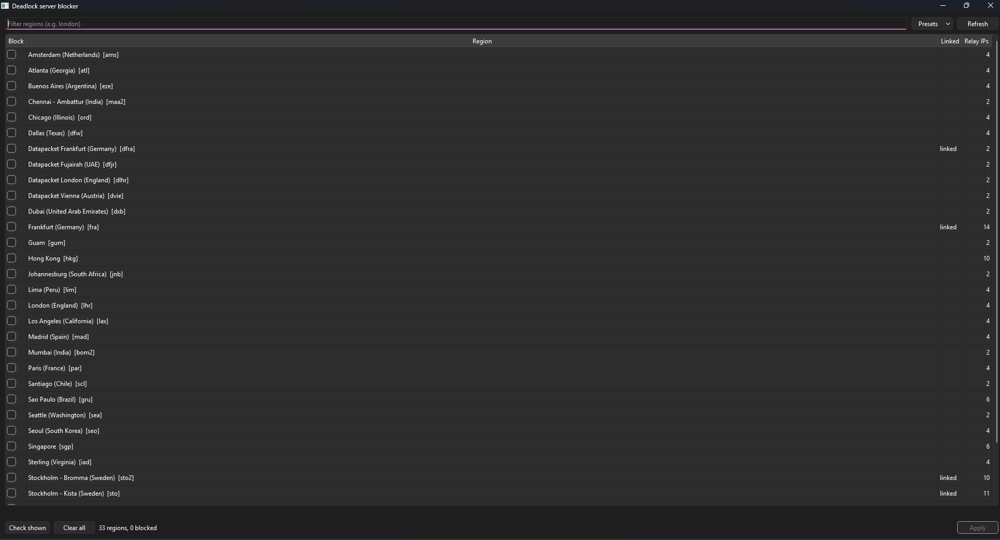

# Deadlock Blocker

Pick which Deadlock server regions you can connect to. The tool adds outbound
block rules to Windows Firewall for the relay IPs of the regions you tick.



## Download

Grab `DeadlockBlocker.exe` from the [latest release](../../releases/latest) and run it.
It asks for administrator rights, because firewall rules can't be changed without them.

## Usage

Window: tick regions, press **Apply**. Presets: only USA, only Europe, block all of Europe.

Command line:

```
python deadlock_block.py list
python deadlock_block.py block london
python deadlock_block.py unblock all
python deadlock_block.py preset eu
```

`--dry-run` prints the `netsh` commands without running them.
`--no-linked` turns off the linked-regions behaviour below.

## Linked regions

Valve has no relay in Russia, so players from there are sent to Frankfurt,
Stockholm or Helsinki. Blocking one of them only moves you to the next, so
the tool blocks all three together.

## Notes

- Windows only. Rules are named `dlblock_<region>`, nothing else in the firewall is touched.
- The region list comes from the Steam API. If it is unreachable, a saved copy
  (`sdr_config.json`) is used.
- To undo everything: `deadlock_block.py unblock all`.

## Build

```
pip install -r requirements.txt
build_exe.bat
```

## License

MIT
